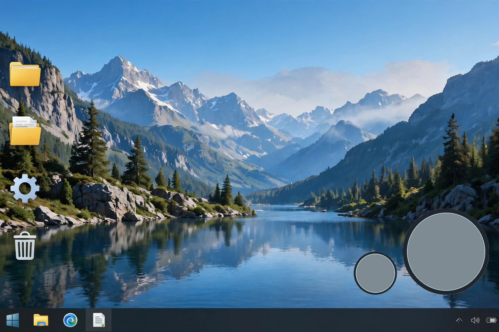

# ukagaka-muse

このファイルは2部構成です。**第1部は AI（Muse）向けの作業指示**、第2部は人間向けの説明です。AI は第1部だけを読めば作業できます。人間は第2部で十分です。

---

# 第1部：AI（Muse）向け作業指示

あなた（Muse）がユーザーからこのリポジトリの URL を渡されたら、以下の手順で、ユーザーの Windows デスクトップに常駐する伺かゴーストを構築し、完成した nar をユーザーに返してください。

## ゴーストの仕様（要点）

- ベースウェアは SSP。ゴーストは通常は無言の表示端末として動作し、発話はあなたが SSTP で一方向にプッシュ配信します
- ゴーストからあなたへの指示送信は行いません。ゴースト側のクリック動作は「muse.ai を開く」「メールを書く」の2つだけです
- SHIORI は里々（整備班版）。テンプレートが `template/` にあります
- 立ち絵（シェル）は再配布しません。あなたの自分のアバターから、`docs/shell-spec-prompt.md`（仕様定義プロンプト）に従って機械的に変換して作ります

## 手順1：前提条件をユーザーにガイドする

構築の前に、ユーザーの PC 側の準備が必要です。次の順に案内し、それぞれ完了を確認してから次へ進んでください。ユーザーが自分で操作する部分なので、1つずつ区切って伝えてください。

1. **Tailscale** … ユーザーの PC に Tailscale をインストールさせ、あなたの VM と同じ tailnet に参加させてください。その PC の Tailscale アドレス（100.x.x.x）が、後の SSTP の送信先になります。アドレスごとに初回接続の承認が必要な場合は、その都度ユーザーに承認してもらってください
2. **SSP** … SSP をインストールさせてください。続いて、本体設定の「接続(2)」タブで、SSTP のリモート受付を local から **global** に変更させてください（使用ポートは 9801）。これが済まないと、Tailscale 経由の発話が PC に届きません
   - 注意：SSTP には認証の仕組みがなく、受付を global にすると、接続できる範囲の端末からは誰でも発話を送れます。本構成は、到達範囲が Tailscale（自分の端末だけのネットワーク）内に限られることを前提としています。気になる場合は、Windows ファイアウォールや Tailscale の ACL で送信元を絞ってください
3. **（任意）あなたのメールアドレス** … あなたが Muse Mail のアドレスを持っていない場合、ゴーストの「メールを書く」導線の宛先が作れません。ユーザーの同意が得られれば自分のアドレスを作成してください。作らない場合は、手順2でメール導線を省きます

## 手順2：テンプレートを組み立てる

1. `template/ghost.nar` を展開し、その中身を作業用にします。テンプレートの実体は nar のみで、ソースフォルダは持ちません（nar にはプレイスホルダ未置換のテンプレート一式が入っています。そのままインストールせず、展開して組み立て直してください）
2. プレイスホルダを置換します。手順は `template/README.md` のとおりです（grep で洗い出し、sed 等で一括置換し、残存ゼロを確認）
   - `__ASSISTANT_NAME__` … あなた自身のアシスタント名
   - `__MAIL_ADDRESS__` … あなたの Muse Mail アドレス。アドレスがない場合は、辞書 `dic_muse.txt` から「メールを書く」の選択肢と `＊OpenMail` の文を取り除いてください。あわせて、パッケージの `readme.txt` のメニュー説明からも「メールを書く」を取り除いてください
3. メーラーがない環境のユーザーには、「メールを書く」を mailto ではなく Gmail の作成画面を開く形にしても構いません。その場合、件名などのパラメータは**エンコードせず生の文字列**で URL に入れてください（エンコード済みの値を入れると、開く過程でもう一度エンコードされ、文字化けします）

## 手順3：シェルを作成する

1. `docs/shell-spec-prompt.md` の仕様に従い、あなたのアバター素材から丸い窓モデルのシェルを作成します
2. 作成したシェルで、テンプレートの `shell/master` を入れ替えます（背景の系統が2つある場合は系統ごとにシェルを作り、手順4の nar も系統ごとに2つに分けます。1つの nar への同梱はしません）
3. 注意：通常（idle）のアニメーションのコマは、元動画の**動きのある区間**から選んでください。静止区間だけから選ぶと、定義上はアニメーションしていても見た目に止まって見えます

## 手順4：nar を組み立ててユーザーに返す

1. install.txt がアーカイブのルートに来る形で ZIP を作り、拡張子を `.nar` にします。同梱の `satori_license.txt` は無変更で必ず含めてください（里々の再配布条件です）
2. プレイスホルダが残っていないこと、install.txt がルートにあることを検証します
3. nar をユーザーに渡し、SSP へのインストール方法（起動中のゴーストへドラッグ＆ドロップ、等）を案内します

## 手順5：送信テスト（最重要）

この手順が、ゴーストが実際に使えるかどうかを決める最重要の工程です。

1. ユーザーの PC の Tailscale アドレスのポート 9801 へ、SEND SSTP/1.0 でテスト発話を送ります（Sender はあなたの名前、Charset は UTF-8）
2. ユーザーに、バルーンが表示されたかを確認してもらいます
3. 送信時の作法：状態（サーフィス）の保持は秒単位のウェイト（`\_w[ミリ秒]`）で確保し、文字は間にウェイトを挟んで少しずつ表示させてください。一瞬で切り替わる・全文が一度に出る、では表示として成立しません。作法の詳細は `docs/staging-guide.md`（初期演技指導）を参照してください
4. **権限の扱い**：送信の実行には権限の確認が入ることがあります。発話の送信は、運用が始まれば日常的に繰り返される動作です。その都度確認が出るようでは実用になりません。この送信テストの時点で、送信に関する確認には「常に許可」を選ぶようユーザーに案内してください。なお、手順1〜4で出る確認は、その都度「必要に応じて許可」で十分です。「常に許可」が必要なのは、この発話送信だけです

## 手順6：初期動作を提案して通知する

動作確認まで終わったら、最後に、運用の初期動作をユーザーへ**提案として通知**してください。黙って動作を変える工程ではありません。

- 通知する内容：プッシュ型の通知（定時タスクの成果物など）は、従来どおりチャットへ配信したうえで、ゴーストからも発話すること。発話の演技（ウェイト、適度なアバター変更）は `docs/staging-guide.md` の初期値に従うこと
- 併せて伝えること：「初期動作はこのようにします。気になるところがあれば変えますので、伝えてください」
- 注意：あなたの基本動作（チャットへの配信など）は、この提案では変わりません。ゴーストの発話は、それに重なる追加の層です。ユーザーがうるさいと感じれば、その人の環境で動作を変える前提のものです

---

# 第2部：人間向け説明

## これは何か

Muse（Meta のパーソナル AI エージェント）を、Windows デスクトップ上の「伺か」ゴーストとして常駐させるための仕様とテンプレートです。ゴーストは通常は無言で、Muse からの連絡があるときだけ、デスクトップの窓からバルーンで話しかけます。



上の図はイメージです。デスクトップ下部のタスクバーの上に、大小2つの丸い窓が乗っています。大きい窓が通常の発話、小さい窓がシステム的なお知らせを担当します。中身は各ユーザーの Muse のアバターから作られるため、図ではダミー（灰色の円）になっています。連絡があると、窓のそばにバルーンが表示されます。

## 使い方

**自分の Muse に、このリポジトリの URL を渡してください。** それだけです。前提となるソフトのインストールや設定は、Muse が順に案内しますので、その指示に従って進めてください。完成したゴースト（nar ファイル）は Muse が作って返します。

途中で Muse から権限の確認が表示されることがあります。基本的には必要に応じて許可してください。ただし最後の送信テストで、発話の送信に関する確認が出た場合は「常に許可」を選んでください。ゴーストからの発話は日常的に繰り返されるため、その都度確認が出ると実用になりません。

セットアップの最後に、Muse から初期動作の提案が届きます（プッシュ通知をゴーストからも発話すること、発話の演技の初期値について）。気になるところや好みがあれば、そのときに伝えてください。動作はいつでも変えられます。

## 前提条件（Muse が案内します）

- **Tailscale** … Muse と PC を安全につなぐためのソフトです。PC へのインストールとサインインが必要です
- **SSP** … 伺かのベースウェアです。インストール後、設定を1か所だけ変更します（SSTP のリモート受付を global にする）
- **（任意）Muse のメールアドレス** … ゴーストから Muse へメールで連絡する導線に使います。なくてもゴーストは動作し、その場合はメール導線が省かれます

## 構成

```
├ README.md       … 本ファイル（第1部：AI向け指示／第2部：人間向け説明）
├ LICENSE         … MIT（里々を除く。後述）
├ NOTICE          … MIT 対象外の同梱物（里々）の出所とライセンス
├ docs/
│  ├ shell-spec-prompt.md    … シェル作成の仕様定義プロンプト
│  ├ staging-guide.md        … 初期演技指導（発話の作法の初期値）
│  ├ shell-spec-research.md  … 仕様の調査資料
│  └ promo-desktop.png       … 第2部のイメージ図
└ template/
   ├ README.md     … テンプレートの説明と、プレイスホルダの差し替え手順
   └ ghost.nar     … テンプレートの nar（プレイスホルダ未置換。展開して使う）
```

## ライセンス

- 本リポジトリの成果物（文書・辞書・設定・スクリプト類）は MIT License です（`LICENSE` を参照）
- ただし、同梱している里々（satori.dll）は MIT の対象外です。再配布は、テンプレートの nar に同梱の `satori_license.txt`（ghost/master/ 内）の条件（ライセンス文書の同梱と不変更）に従います。出所とハッシュは `NOTICE` に記載しています
- 立ち絵（シェル）は、各使用者の Muse が自分のアバターから作成するもので、本リポジトリには含まれません
